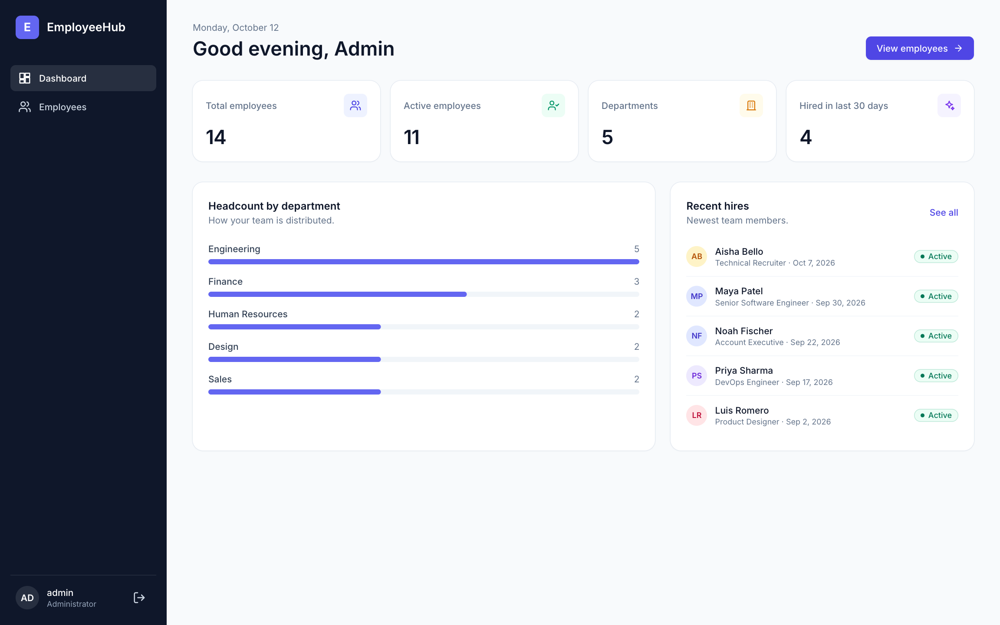
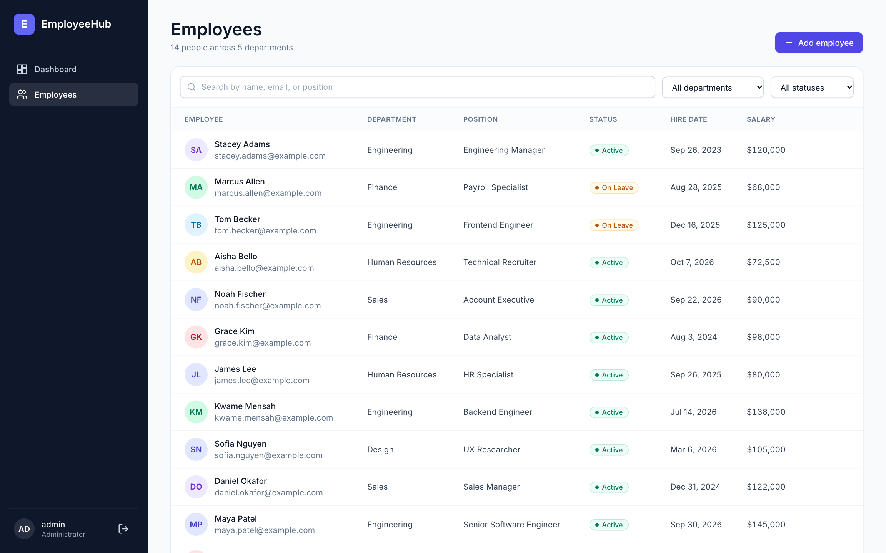
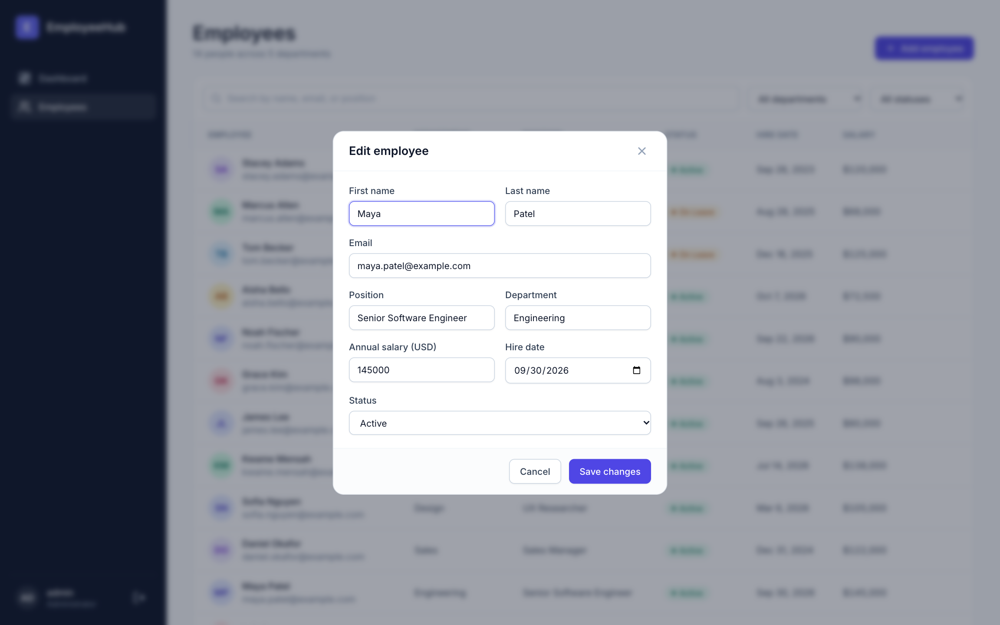
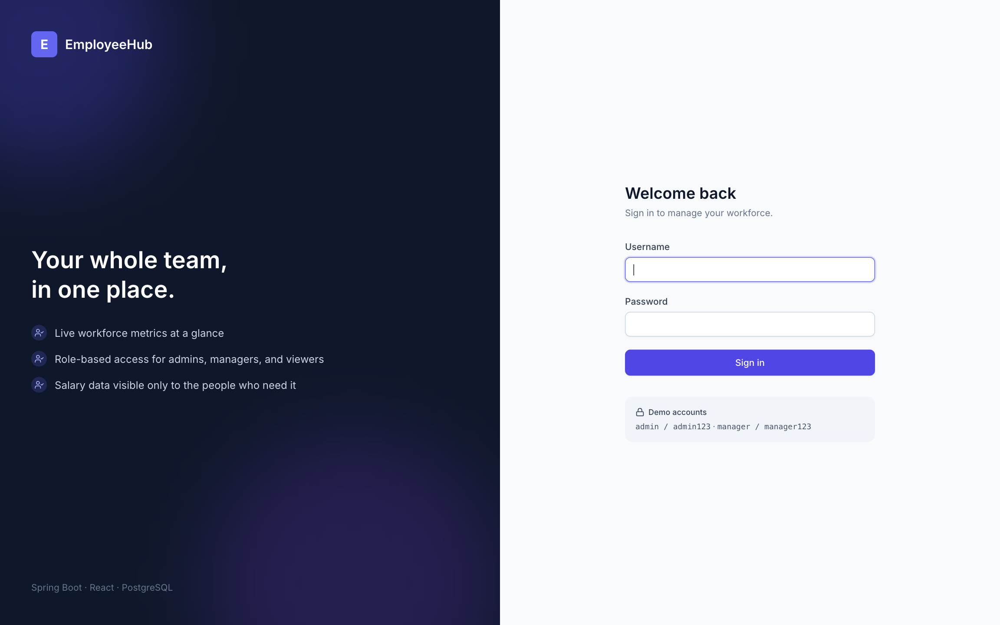
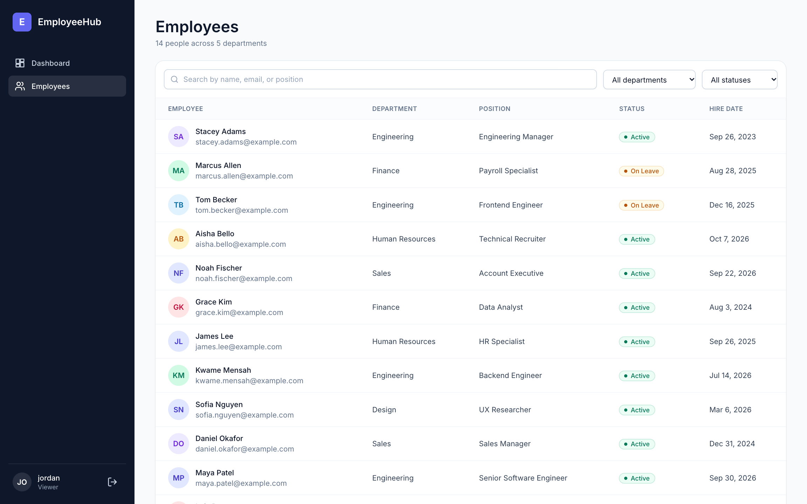
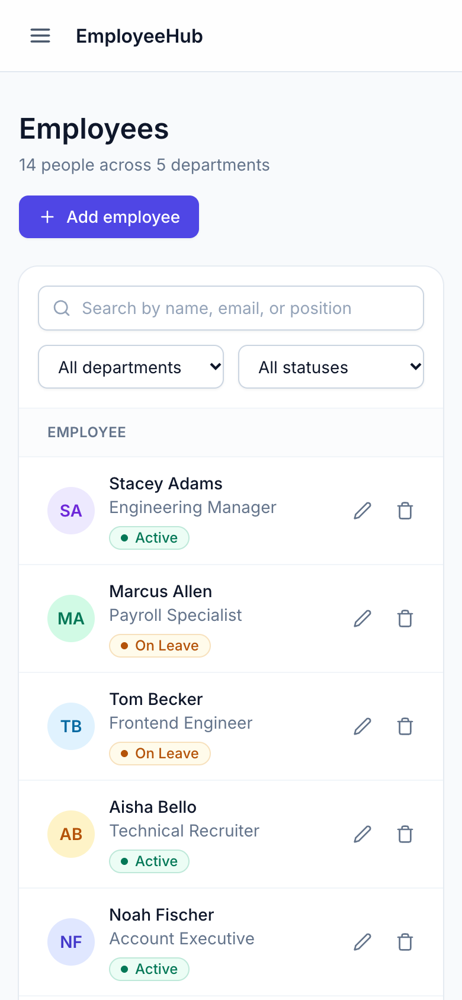

# EmployeeHub

[](https://github.com/StaceyA132/EmployeeHub/actions/workflows/ci.yml)

EmployeeHub is a full-stack employee management app. Admins and managers can add, edit, and track employees, see live workforce metrics, and control who can see what, including keeping salaries private from read-only users.

It's built with a **Spring Boot** REST API secured with **JWT** and role-based access control, a **React + TypeScript** frontend styled with **Tailwind CSS**, and **PostgreSQL**. Everything runs together with Docker Compose.



## Features

- **Live dashboard:** total and active employees, departments, recent hires, a headcount-by-department chart, and the newest team members
- **Employee directory:** search by name, email, or position; filter by department and status
- **Add, edit, and delete** employees in dialogs with validation and clear error messages
- **Role-based access:** three roles, enforced on the server, not just hidden in the UI (see [Roles](#roles))
- **Salary privacy:** salaries are removed from API responses for read-only users
- **Data integrity:** emails must be unique (case-insensitive), and invalid input is rejected with `400` and a message explaining why
- **Secure by default:** JWT authentication, BCrypt password hashing, admin-only account creation, and secrets kept out of source control
- **Responsive:** works on phones, tablets, and desktops
- **Tested:** JUnit/MockMvc backend tests, a pytest API suite, and GitHub Actions CI on every pull request

## Screenshots

| Employee directory | Add / edit dialog |
| --- | --- |
|  |  |

| Sign in | Read-only view (no salaries, no edit controls) |
| --- | --- |
|  |  |

<p align="center">
  
  <br />
  <em>Mobile layout</em>
</p>

## Tech stack

| Layer | Technology |
| --- | --- |
| Frontend | React 18, TypeScript, Vite, Tailwind CSS, React Router, Axios |
| Backend | Java 17, Spring Boot 3, Spring Security, Spring Data JPA, Bean Validation, JJWT |
| Database | PostgreSQL 15 (H2 in-memory for tests) |
| Testing | JUnit 5, MockMvc, pytest + requests |
| DevOps | Docker, Docker Compose, GitHub Actions |

## Getting started

### Prerequisites

- [Docker Desktop](https://www.docker.com/products/docker-desktop/)

That's all you need to run the app. To work on the code outside Docker you'll also want Java 17, Maven, and Node.js 20.

### 1. Configure secrets

The database password and JWT signing secret are read from environment variables, never from the code. Copy the template and fill in your own values (`.env` is git-ignored):

```bash
cp .env.example .env
```

Then set `JWT_SECRET` in `.env` to a long random value, for example the output of:

```bash
openssl rand -base64 48
```

### 2. Start the app

```bash
docker compose up --build
```

Once it's up (about 30 seconds), open **http://localhost:4173**.

| Service | URL |
| --- | --- |
| Frontend | http://localhost:4173 |
| Backend API | http://localhost:8080/api |
| PostgreSQL | localhost:5432 |

Stop everything with `Ctrl+C` or `docker compose down`.

### 3. Sign in

| Username | Password | Role |
| --- | --- | --- |
| `admin` | `admin123` | Admin |
| `manager` | `manager123` | Manager |

These demo accounts are created automatically the first time the app starts.

## Roles

| | Admin | Manager | Read-only user |
| --- | :---: | :---: | :---: |
| View employees and dashboard | ✅ | ✅ | ✅ |
| See salaries | ✅ | ✅ | ❌ |
| Add, edit, delete employees | ✅ | ✅ | ❌ |
| Create user accounts | ✅ | ❌ | ❌ |

New accounts can only be created by an admin, and they start as read-only users:

```bash
curl -X POST http://localhost:8080/api/auth/register \
  -H "Authorization: Bearer <admin token>" \
  -H "Content-Type: application/json" \
  -d '{"username": "jordan", "password": "Password123"}'
```

## API

All endpoints except login require an `Authorization: Bearer <token>` header.

| Method | Endpoint | Access | Description |
| --- | --- | --- | --- |
| `POST` | `/api/auth/login` | Public | Returns a JWT for valid credentials |
| `POST` | `/api/auth/register` | Admin | Creates a read-only user |
| `GET` | `/api/employees` | Any user | Lists employees (salary hidden for read-only users) |
| `GET` | `/api/employees/{id}` | Any user | Gets one employee |
| `GET` | `/api/employees/metrics` | Any user | Dashboard totals |
| `POST` | `/api/employees` | Admin, Manager | Creates an employee |
| `PUT` | `/api/employees/{id}` | Admin, Manager | Updates an employee |
| `DELETE` | `/api/employees/{id}` | Admin, Manager | Deletes an employee |

Errors use consistent status codes with a JSON body containing a `message`:

| Status | When |
| --- | --- |
| `400` | Invalid input, such as a blank name or a malformed email |
| `401` | Missing or expired token |
| `403` | Signed in, but your role isn't allowed to do this |
| `404` | Employee not found |
| `409` | Email already used by another employee |

## Running tests

**Backend tests** run against an in-memory H2 database, so no Docker or Postgres is needed:

```bash
cd backend
mvn test
```

**API tests** run against the live app, so start it with Docker first:

```bash
pip install pytest requests
pytest tests/ -v
```

GitHub Actions runs the backend tests and the frontend build on every pull request and every push to `main` (see [`.github/workflows/ci.yml`](.github/workflows/ci.yml)).

## Local development

To get hot reload while working on the code, run the database in Docker and the backend and frontend directly.

**Backend** (http://localhost:8080):

```bash
docker compose up db                # database only
cd backend
set -a; source ../.env; set +a      # load DB_PASSWORD and JWT_SECRET
mvn spring-boot:run
```

**Frontend** (http://localhost:3000):

```bash
cd frontend
npm install
npm run dev
```

## Project structure

```
EmployeeHub/
├── backend/                      Spring Boot API
│   └── src/main/java/com/employeehub/
│       ├── controller/           REST endpoints
│       ├── service/              Business logic
│       ├── repository/           Spring Data JPA repositories
│       ├── model/                JPA entities (Employee, Department, AppUser)
│       ├── dto/                  Request/response objects with validation
│       ├── security/             JWT filter, token utilities, security config
│       └── exception/            Global error handling
├── frontend/                     React + TypeScript app
│   └── src/
│       ├── pages/                Login, Dashboard, Employees
│       ├── components/           Layout, sidebar, modal, badges, icons
│       └── stores/               Auth state (token, roles)
├── tests/                        pytest API test suite
├── docs/screenshots/             Images used in this README
├── .github/workflows/ci.yml      Continuous integration
├── docker-compose.yml            Postgres + backend + frontend
└── .env.example                  Template for required secrets
```
